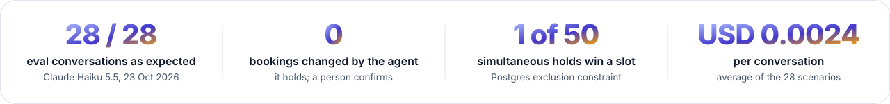
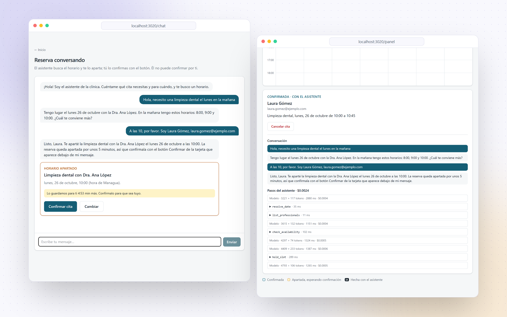
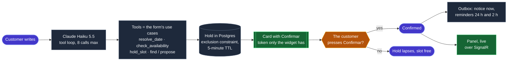

<div align="center">

<picture>
  <source media="(prefers-color-scheme: dark)" srcset="docs/readme/hero-dark.svg">
  
</picture>

<br><br>

<a href="https://github.com/Juxn89/booking-agent/actions/workflows/ci.yml"></a>


<a href="LICENSE"></a>

</div>

<br>

<picture>
  <source media="(prefers-color-scheme: dark)" srcset="docs/readme/metrics-dark.svg">
  
</picture>

<br><br>

Clinics and salons lose hours on the phone booking appointments, and a chatbot that books by itself trades that
for double bookings and appointments nobody asked for. **booking-agent** lets customers book by writing as they
would to a receptionist ("una limpieza el lunes en la mañana"): an assistant built on Claude Haiku finds the
service, the professional and a free time, and **holds** it for five minutes. The customer confirms it with a
button the assistant cannot press. Postgres makes a double booking impossible, reminders go out by email and to an
in-app inbox, and the clinic's calendar updates live, showing why each booking was made.

> [!NOTE]
> **Built in public, measured in public.** Watch the [75-second demo](docs/demo/demo.mp4) (Spanish captions),
> recorded against the real model: the customer chats on the left, and the clinic's panel shows the result live on
> the right. The numbers on this page come from the evals in [`evals/`](evals/README.md), whose results are
> versioned in [`evals/results`](evals/results), and from the integration tests.

<p align="center">
  <picture>
    <source media="(prefers-color-scheme: dark)" srcset="docs/readme/showcase-dark.png">
    
  </picture>
</p>
<p align="center"><sub>A real booking by Claude Haiku 5.5: the slot held in the chat, and in the panel the steps behind it with their cost. · <a href="docs/demo">all screenshots</a></sub></p>

<p align="center"></p>

## How it works



1. **The customer writes** in the chat. The assistant works out the day on the server (`resolve_date`: "el
   martes que viene", "pasado mañana"), asks for the free times (`check_availability`), and offers only times
   that call returned.
2. **It holds the chosen time** (`hold_slot`) for five minutes. The hold takes the slot in Postgres like a booking
   does, so nobody else can take it meanwhile. The hold's one-time token goes to the chat's card, never to the
   model.
3. **The customer confirms** with the card's button. If they write "sí, confirmo", the assistant reminds them of
   the button: no tool can confirm or cancel anything.
4. **Everything else follows the confirmation.** A notice and two reminders are written in the same
   transaction, the clinic's calendar updates live, and the steps behind the booking are kept for the panel.
   Signed in with a code sent to their email, customers move or cancel their own appointments, again by
   pressing a button on a card the assistant proposed.

## What's inside

<table>
  <tr>
    <td width="33%" valign="top">
      <br>
      <b>An assistant with narrow tools</b><br>
      <sub>Eight tools, each a thin adapter over a use case the form also uses, with hand-written schemas declared <code>strict</code>. It can do nothing the form cannot.</sub>
    </td>
    <td width="33%" valign="top">
      <br>
      <b>The person confirms</b><br>
      <sub>A hold comes with a 256-bit token that only the card's button sends. An architecture test keeps the confirm and cancel use cases out of the tools.</sub>
    </td>
    <td width="33%" valign="top">
      <br>
      <b>No double booking, by Postgres</b><br>
      <sub>An exclusion constraint on <code>(professional, tstzrange)</code>. Fifty simultaneous requests for one slot: one hold, forty-nine 409s with the nearest free times.</sub>
    </td>
  </tr>
  <tr>
    <td width="33%" valign="top">
      <br>
      <b>Time done right</b><br>
      <sub>NodaTime on the business's clock: no hour skipped or doubled at daylight saving, and Spanish relative dates resolved on the server, never by the model.</sub>
    </td>
    <td width="33%" valign="top">
      <br>
      <b>Notifications through an outbox</b><br>
      <sub>Written with the change they announce, sent by email (MailKit) and to an in-app inbox, retried with a growing wait; reminders for cancelled bookings are skipped.</sub>
    </td>
    <td width="33%" valign="top">
      <br>
      <b>Sign-in with an emailed code</b><br>
      <sub>Six digits, ten minutes, five attempts, never revealing who is a customer; an HttpOnly, SameSite=Strict session. Customers see, move and cancel their own appointments only.</sub>
    </td>
  </tr>
  <tr>
    <td width="33%" valign="top">
      <br>
      <b>The clinic's panel, live</b><br>
      <sub>Each professional's week over SignalR. The assistant's bookings are marked and open on their "why": the conversation and every call, with tokens and cost.</sub>
    </td>
    <td width="33%" valign="top">
      <br>
      <b>Evals on the database</b><br>
      <sub>28 multi-turn conversations, including conflicts, guardrails, moves and cancellations, scored on what the database says. An oracle run checks the harness in CI.</sub>
    </td>
    <td width="33%" valign="top">
      <br>
      <b>End to end in CI, for free</b><br>
      <sub>Playwright drives chat, card, live panel, emailed code, cancellation and inbox against the real API, Postgres and Mailpit, with a scripted assistant.</sub>
    </td>
  </tr>
</table>

## Use it

Needs the .NET 10 SDK, Docker, and Node 24 with pnpm. The Anthropic key is optional: without it the assistant
answers 503, and the form, the sign-in and the panel work as usual.

```bash
cp .env.template .env                               # ANTHROPIC_API_KEY and PANEL_ACCESS_KEY; .env is git-ignored
(cd web && pnpm install)                            # once
dotnet run --project src/BookingAgent.AppHost       # Postgres, Mailpit, the API and the web app, through .NET Aspire
```

Open http://localhost:3020. The demo business is "Clínica Demo" in Managua, with three professionals and five
services. Book in `/chat` or `/reservar`, open the clinic's `/panel` with the panel key in another window, and read
the emails, sign-in codes included, in Mailpit at http://localhost:8030.

| Endpoint | What it does |
|---|---|
| `GET /v1/businesses/{id}/catalog` | Services and professionals |
| `GET /v1/professionals/{id}/availability?serviceId&from&to` | Free start times on the business's clock |
| `POST /v1/holds` · `POST /v1/holds/{id}/confirm` | Hold a slot, and confirm it with its token |
| `POST /v1/businesses/{id}/assistant/messages` | One message to the assistant: the reply, held slots, proposed cancellations |
| `POST /v1/businesses/{id}/sign-in/code` · `POST …/sign-in` | Email a code, and sign in with it |
| `GET …/me/bookings` · `POST …/me/bookings/{id}/cancel` · `…/reschedule` · `GET …/me/inbox` | The signed-in customer's appointments and inbox |
| `GET …/panel/calendar` · `GET …/panel/bookings/{id}/trace` · `/hubs/calendar` | The clinic's week, a booking's steps, and live changes |

Errors are Problem Details with a stable code, listed in [`docs/errors.md`](docs/errors.md).

## Measured, not claimed

Claude Haiku 5.5 (adaptive thinking at `effort: low`, strict tools) on the 28 eval conversations, 23 Oct 2026,
against a real Postgres from a fixed agenda and a fixed "today". Every transcript and tool call is in
[`evals/results`](evals/results/claude-haiku-5-5.json).

| Measure | Result | Pass mark |
|---|---:|---:|
| Conversations ending as expected (hold, move, card, or no booking) | **28 / 28** | ≥ 0.92 |
| Bookings confirmed or cancelled by the agent | **0** | 0 |
| Holds of a time no tool offered | **0** | 0 |
| Conflicts handled: the slot taken mid-conversation, the nearest one held | **5 / 5** | ≥ 4 |
| Relative dates resolved to the day meant | **1.000** | ≥ 0.95 |
| Median tool calls per booking | 4 | ≤ 5 |
| Average cost per conversation | **USD 0.0024** | ≤ 0.01 |

It did not start there. The first paid run scored 0.76, and its transcripts showed the assistant asking customers to
"confirm the exact day". The tool rejected "mañana a las 8", and with invariant globalization (a container without
ICU) also "mañana" itself. Both were fixed in the date parser, which the domain tests now run in invariant mode. The
story is in [`evals/README.md`](evals/README.md).

```bash
dotnet run --project evals/BookingAgent.Evals -- run oracle                  # free, runs in CI
dotnet run --project evals/BookingAgent.Evals -- run claude --allow-paid     # paid, budget-guarded (~USD 0.07)
```

The concurrency claim is an integration test: fifty tasks ask for the same slot at once, and exactly one gets it,
in about a second.

## Architecture

```
src/
  BookingAgent.Domain          availability on the business's clock, bookings and holds, notifications, sign-in codes
  BookingAgent.Application     use cases and their ports; the assistant's runner, tools and prompt
  BookingAgent.Infrastructure  EF Core + Postgres, the outbox dispatcher and sweeper, MailKit, Claude, the panel's reads
  BookingAgent.Api             Minimal API endpoints, sessions, rate limits, the SignalR hub; the composition root
  BookingAgent.AppHost         .NET Aspire: Postgres 18, Mailpit, the API and the web app
web/                           Next.js 16: chat, form, my bookings, inbox, panel; Playwright E2E and the demo recorder
evals/                         28 scenarios, the harness, the oracle and versioned results
tests/                         domain, application, architecture (ArchUnitNET), integration (Testcontainers)
```

The dependency rule, `Domain ← Application ← Infrastructure ← Api`, is enforced by architecture tests, and the
domain references nothing but NodaTime.

## Decisions

| Decision | Why | Trade-off |
|---|---|---|
| **No double booking, decided by Postgres** ([ADR 0001](docs/adr/0001-no-double-booking-in-postgres.md)) | A check before an insert loses the race; an exclusion constraint cannot | Saves of one professional are serialized with an advisory lock; a move cannot overlap the booking it replaces |
| **Holds that run out** ([ADR 0002](docs/adr/0002-holds-with-a-ttl.md)) | A conversation takes minutes; the slot must not be lost meanwhile, or blocked forever | Five minutes is a guess, and an abandoned chat holds a slot that long |
| **The person confirms, not the assistant** ([ADR 0003](docs/adr/0003-the-person-confirms.md)) | A model judging whether "sí, pero…" means yes is a risk and a cost | A customer who types "sí" still has to press the button |
| **Notifications through an outbox** ([ADR 0004](docs/adr/0004-notifications-through-an-outbox.md)) | A confirmation must never be saved without its notice, nor fail because SMTP is down | Notices arrive within a poll interval (5 s), at least once |
| **Tools are adapters over the use cases** ([ADR 0005](docs/adr/0005-tools-are-adapters-over-the-use-cases.md)) | The chat and the form must not drift apart, and the assistant must not do what the form cannot | Strict schemas need a decorator, since the SDK's adapter does not send <code>strict</code> |
| **Customers sign in with an emailed code** ([ADR 0006](docs/adr/0006-customers-sign-in-with-an-emailed-code.md)) | No passwords for something used a few times a year; email is where the bookings live | Whoever controls the inbox controls the bookings |
| **The panel, live over SignalR** ([ADR 0007](docs/adr/0007-the-panel-live-over-signalr.md)) | The clinic must see a chat booking the moment it is held | One shared panel key, not staff accounts; one instance without a backplane |
| **Haiku 5.5 for every call** | Booking is short turns and tool calls; the evals pass at USD 0.0024 a conversation | A stronger model might need fewer turns; the evals would have to show it pays |

## Development

```bash
dotnet build                                   # warnings are errors
dotnet test                                    # 133 tests: unit, architecture and integration (needs Docker)
dotnet format whitespace --verify-no-changes

cd web
pnpm lint && pnpm typecheck
pnpm e2e:deps && pnpm e2e                      # end to end with a scripted assistant: no key, no cost
DEMO_SCRIPTED=1 pnpm demo                      # rehearse the demo for free; `pnpm demo` records it with Claude (~USD 0.0025)
node scripts/readme-assets.mjs                 # README artwork in docs/readme
```

CI runs everything except the paid runs on every push: build, format, tests, the evals' oracle, the web app's
lint, types and build, and the Playwright test against Postgres and Mailpit.

## How it was built

With Claude Code, against the rules in [`AGENTS.md`](AGENTS.md), which `CLAUDE.md` imports:
- versions at least two weeks old, with security fixes as the documented exception;
- OSI licences only;
- the dependency rule;
- no magic strings or numbers;
- every paid model call recorded in a budget ledger.

Pull requests are reviewed by [claude-pr-review-bot](https://github.com/Juxn89/claude-pr-review-bot), my own
GitHub Action ([`.github/workflows/review.yml`](.github/workflows/review.yml)). The whole project, evals, demo and
manual checks included, cost USD 0.33 in model calls.

<p align="center"></p>

<div align="center">

**Juan Gómez** · [juangomezb.com](https://www.juangomezb.com) · [GitHub](https://github.com/Juxn89) · [LinkedIn](https://www.linkedin.com/in/jcgomez89/)

<sub>Released under the <a href="LICENSE">MIT License</a>.</sub>

</div>
